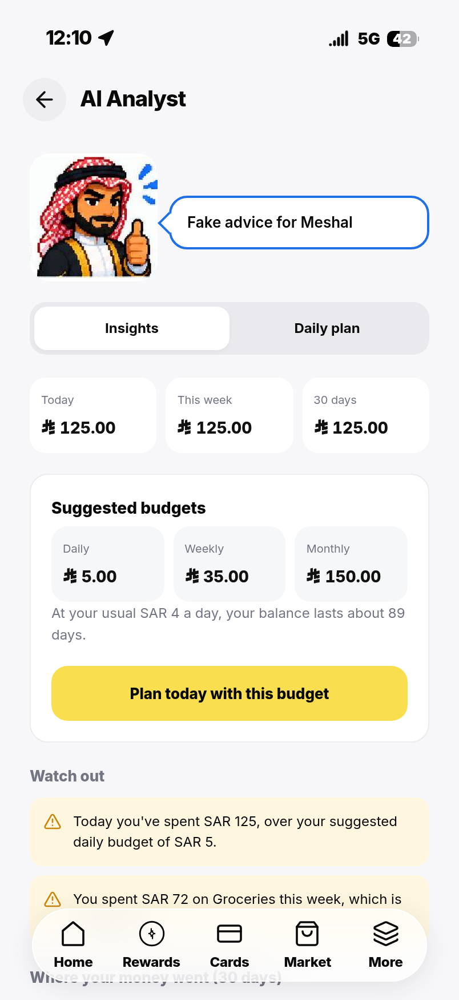
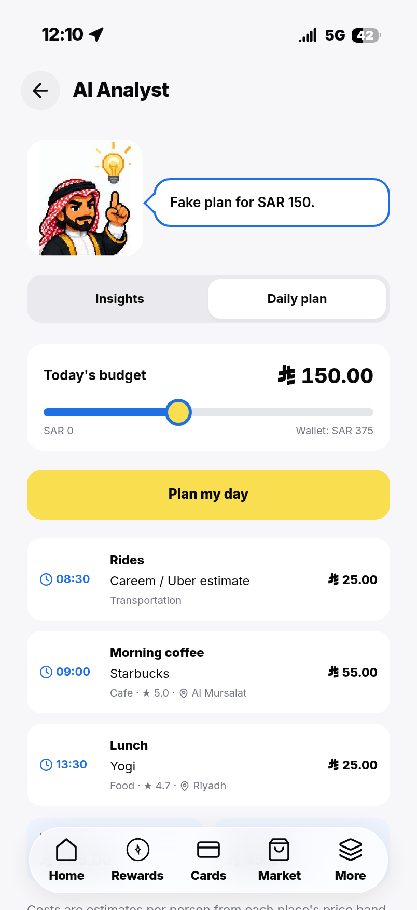
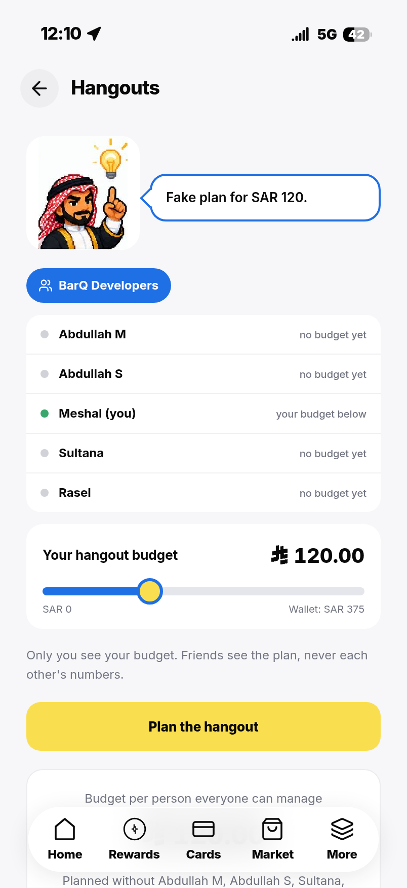
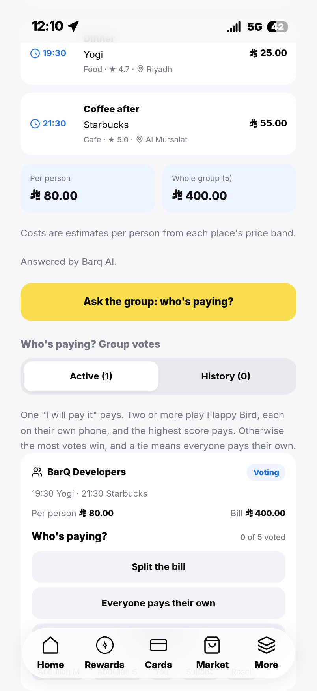
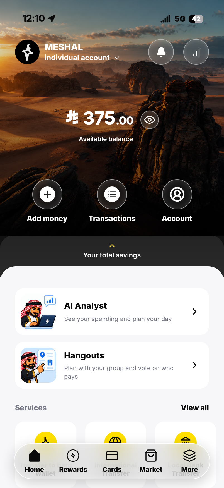
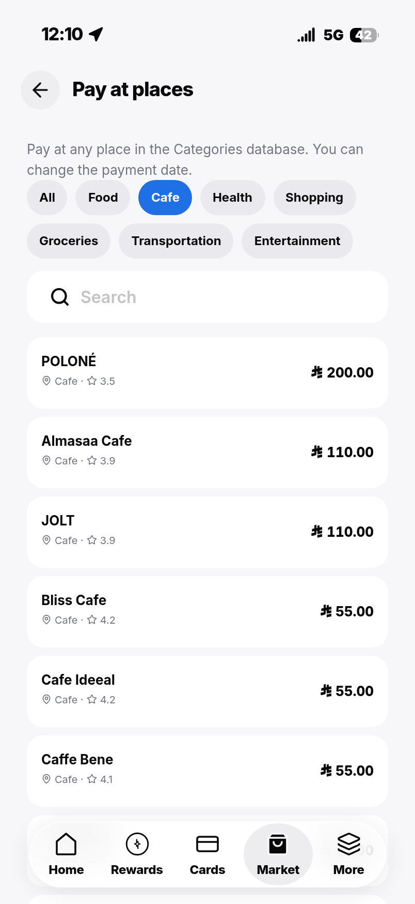
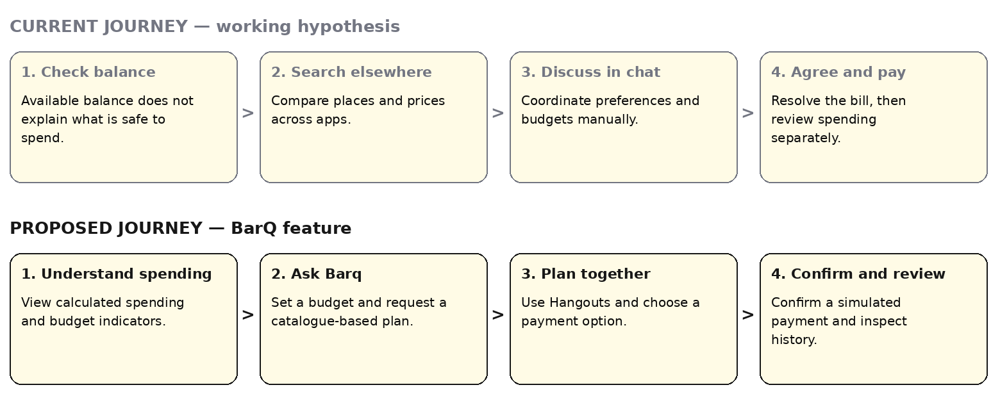
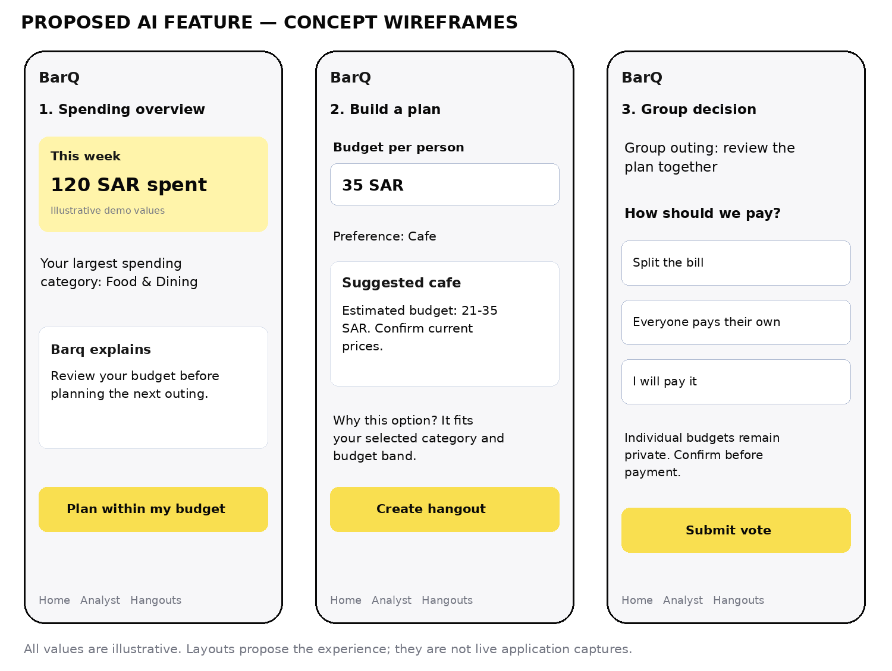

# BarQ — Smart Spending & Hangouts

**AI Feature Innovation Project — Project Report**

{width=5.6in}

*BarQ prototype product mark.*

**Target organization:** barq, Saudi Arabia  
**Proposed feature:** Barq AI spending assistant and budget-aware group planning  
**Team members:**  
Meshal Khaled  
Abdullah AlMalki  
Abdullah alsehli  
Sultana AlOtaibi  
Rasel AlZayed  
**Date:** 29 October 2026

An independent student prototype inspired by barq’s digital wallet experience. It is not an official barq product and is not affiliated with or endorsed by the organization. Prototype balances, transfers and payments use mock money.

**Report basis.** This report follows Deliverable 1 in the supplied *AI Feature Innovation Project* instructions. It draws on the project report and README at repository commit `070115436f7cb7cc593f735f5308a13fcd88457d`, the places dataset, and the team’s separate estimated-price exports. Implementation and full-suite test outcomes are attributed to those records. New screenshots and limited interaction checks were produced from an isolated copy of the same commit using mock accounts and the repository’s local AI test service; this is not a live deployment audit. Primary user-research findings remain to be supplied.

## 2. Executive Summary

Digital wallets make it convenient to view balances and initiate payments. An additional opportunity is to help people translate their spending information into practical everyday choices: what they can afford, where they could go, and how a group will share a bill. BarQ explores that opportunity through a focused AI feature for a barq-inspired prototype.

The proposed feature combines calculated spending insights, conversational explanations, budget-aware suggestions from a Riyadh places catalogue, and a group Hangouts flow. The server calculates financial totals and validates suggestions; AI helps express advice and generate a plan. Users retain control of payment decisions.

Financial-literacy research supports the broader importance of informed financial decisions, but it does not establish that barq users experience this exact problem or that this feature will improve outcomes. Organization-specific interviews and usability testing are therefore part of the validation plan, not completed research.

Expected benefits include easier outing planning, clearer spending awareness and less manual group coordination. Organizational value could include useful engagement and stronger retention. These are hypotheses to measure through task-based testing and a controlled pilot. The prototype demonstrates feasibility; it does not demonstrate real banking integration, verified merchant pricing or production readiness.

## 3. Target Organization

### Organization overview

The selected organization is barq, a Saudi digital wallet/payment service. Its wallet context makes spending support and payment-related coordination a relevant area to explore. The organization’s official website is listed in Reference [1]; current product details should be checked there before submission because external-site retrieval was blocked during report preparation.

### Rationale for selection

The team selected a familiar mobile-wallet context in which a user already checks a balance and initiates payments. This provides a plausible place for contextual spending assistance without requiring a separate standalone budgeting application. The project’s interface is an independent reconstruction, as stated in its README [5]. No access to barq’s internal systems, customer data or product roadmap is claimed.

### Improvement opportunity and scope

The proposal improves the decision process around discretionary spending and group outings. The core use case is: “Help me understand my spending and choose an outing within a budget, then agree with friends how to pay.” It does not propose replacing the organization’s core wallet, credit decisions or payment infrastructure. It is also not a claim that the official barq application lacks an equivalent capability; a current feature comparison is still required.

## 4. Industry Background

Digital financial services bring payment activity and transaction information into an interface people can access regularly. However, access to a balance does not by itself establish that a person understands their financial position or feels confident about a spending choice. Financial capability and financial well-being provide useful context for designing supportive features.

Lusardi and Mitchell’s review explains the economic importance of financial literacy and its relationship to financial decision-making [2]. The Consumer Financial Protection Bureau’s financial well-being framework emphasizes control over day-to-day finances, resilience and freedom to make choices [3]. These sources justify investigating decision support; they do not prove a specific product gap in Saudi Arabia or barq.

### Existing approaches and their limits for this use case

- **Wallet histories and category summaries** help users review transactions. A summary alone may leave the user to decide what action to take next.
- **Budget trackers** organize spending limits but may require users to translate those limits into a suitable activity or venue.
- **Maps and venue directories** support discovery but generally need additional personal budget context to form an affordable plan.
- **Group chats and bill-splitting workflows** support coordination, although moving between discovery, discussion and payment can add steps.

These are functional categories, not a verified competitor ranking. BarQ’s proposed distinction is to connect the steps around one outing. A competitive review and user study should test whether that connection solves a meaningful unmet need.

## 5. Problem Validation

### Evidence available and what it establishes

| Evidence | Supported finding | Limit of the evidence |
| --- | --- | --- |
| Financial-literacy research review [2] | Financial understanding is relevant to economic decisions; decision support is a reasonable area to investigate. | Does not establish barq-specific pain points or test this feature. |
| CFPB financial well-being framework [3] | Everyday financial control and the ability to make choices are relevant outcome dimensions. | Developed outside this organization; local applicability needs validation. |
| Project report and README [4–5] | The team documents a wallet, calculated insights, AI planning, Hangouts and stored prototype payment flows. | Demonstrates a documented implementation, not market demand or user benefit. |
| Local dataset inspection [6] | The v2 dataset contains 208 entries, including 100 restaurants and 50 cafés, providing a local planning catalogue. | Coverage, freshness and merchant prices are not established by record counts. |

The academic and institutional references provide background support. Their full text was not retrieved in this task because external research websites were blocked. No new statistics, quotations, survey responses or interview findings are presented as verified evidence.

### Validation still needed

The central problem remains a product hypothesis. A small exploratory study should recruit 8–12 consenting adult wallet users in Riyadh who sometimes organize group outings. This proposed sample supports discovery; it is not a statistically representative survey.

Ask participants to describe their last real outing, the tools used, how they chose a budget, any uncomfortable payment discussions, and how they checked spending afterward. Record observed steps and anonymized themes. Avoid leading with the AI solution. With permission, use participant-provided examples without collecting PINs, account credentials or unnecessary transaction details.

Then compare a baseline planning task with a BarQ prototype task using similar scenarios. Observe completion time, successful plan selection, budget comprehension and payment-rule understanding. The team should revise or reject the problem statement if participants do not demonstrate the assumed difficulty. Findings belong in the final report only after the research is actually completed.

## 6. Problem Statement

**Working problem statement:** Adults who use a digital wallet and help organize group outings may need to combine spending history, venue information and group preferences across several tools. This can make it harder to choose an affordable outing and agree how to pay. A useful solution should reduce that coordination effort while keeping budget information understandable and individual payment choices under user control.

The affected users are individual planners and participating friends. Potential effects include time spent comparing options, uncertainty about affordability and awkward discussions over the bill. For the organization, an unresolved need could limit the usefulness of the wallet between transactions. These effects are proposed explanations to test, not measured findings.

The project succeeds at the problem level only if users can make a suitable decision more easily and understand its cost. Generating more AI responses is not itself success.

## 7. Target Users

### Primary segment

The initial research segment is adult digital-wallet users in Riyadh who make discretionary restaurant or café purchases and occasionally plan outings with friends. Choosing one city keeps venue coverage and research scope manageable. No age distribution, market size or level of demand has been measured.

### Illustrative user profiles

- **The outing organizer:** wants to select a place, respect friends’ budgets and agree on payment without repeated messages. Needs a manageable list of options and a clear group decision.
- **The budget-conscious participant:** wants to participate without publicly disclosing an individual budget. Needs affordable suggestions and explicit control over what they owe.
- **The individual planner:** wants to understand recent spending and choose a reasonable next activity. Needs concise explanations grounded in transaction facts rather than generic advice.

These are design profiles, not personas derived from completed interviews. Accessibility, language preferences and the clarity of price estimates should be evaluated with participants.

## 8. Proposed AI Solution

### Concept and fit

**Barq Smart Spending & Hangouts** adds a planning layer around the wallet. A user can review calculated spending, ask for an explanation, set an outing budget and request a plan. The assistant selects from the available catalogue. The user may then create a group outing, choose a payment arrangement and confirm a simulated payment.

### How it works

1. The application reads the signed-in user’s stored prototype transactions and selected planning constraints.
2. Server logic calculates summaries and budget indicators. These amounts do not depend on a language model doing arithmetic.
3. The AI receives the planning context needed to generate advice or a structured plan using catalogue places.
4. The server validates returned data, including recognized place identifiers and budget constraints, before displaying it. The repository describes a fallback AI provider for primary-provider failures [4–5].
5. The user reviews the result and explicitly chooses the next action. Application rules, rather than generated text, process wallet operations and group payment outcomes.

### Why AI is appropriate

AI is useful for interpreting flexible preferences, expressing explanations in ordinary language and organizing a proposed plan. Deterministic code remains appropriate for balances, totals, eligibility checks and payment rules. The feature should use AI where language and preferences matter while keeping financial state changes governed by application logic.

### Data and implementation boundaries

The prototype uses React/TypeScript, a Node.js server and JSON-backed Users, Games, Payments and Places storage [4–5]. The report describes 26 backend and 26 browser tests passing; those suites were not rerun for this report. Test evidence for implementation does not replace usability or demand validation.

The source dataset’s restaurant/café tiers are relative, not verified SAR amounts. The local exports separately map them to estimated whole-SAR budgets per person:

| Tier | Restaurant meal | Café drink/snack |
| --- | --- | --- |
| `$` | 0–35 SAR | 0–20 SAR |
| `$$` | 36–75 SAR | 21–35 SAR |
| `$$$` | 76–150 SAR | 36–60 SAR |
| `$$$$` | 151+ SAR | 61+ SAR |

These estimates are not actual menu prices. Zero denotes the lowest band, not free food. Their integration into the deployed application has not been verified. A production planner should show uncertainty and obtain current prices before describing an option as affordable with confidence.

### Product screenshots — captured prototype

The following screens were captured from the running prototype at the report’s pinned commit. Accounts, balances and purchases are mock data. AI replies come from the repository’s deterministic test service, which labels its messages “Fake advice” and “Fake plan.” These captures demonstrate interface behavior, not a live AI-provider evaluation.

| Spending insights | Budget-aware daily plan |
| --- | --- |
| {width=2.65in} | {width=2.65in} |
| **Figure 1.** Calculated spending and advice in the Analyst. | **Figure 2.** A 150 SAR planning scenario with catalogue places and the Barq character. |

| Hangouts planning | Group payment choices |
| --- | --- |
| {width=2.65in} | {width=2.65in} |
| **Figure 3.** A generated group plan with private-budget controls. | **Figure 4.** Voting choices in a mock hangout created through the interface. |

| Wallet home | Cafés in the places catalogue |
| --- | --- |
| {width=2.65in} | {width=2.65in} |
| **Figure 5.** A mock balance after recorded test purchases. | **Figure 6.** Café filtering in Pay at places; the filter returned 50 entries. |

**Capture validation:** checked wallet balance persistence after mock purchases, calculated spending insights, daily-plan rendering, Hangouts planning, creation of a group vote through the interface, and filtering the 208-place catalogue to 50 cafés. No browser page errors were observed in the completed capture flow. The temporary database was stored outside the app source folder so its writes did not trigger development-server reloads. These are focused interaction checks; the full backend/browser suites and real AI services were not rerun.

## 9. Core Features

| Feature | Capability | User value | Evidence/status |
| --- | --- | --- | --- |
| Spending overview | Calculated summaries and category information. | Makes recorded spending easier to understand. | Documented prototype capability [4–5]. |
| AI explanations | Converts spending context into concise tips and explanations. | Reduces effort interpreting financial information. | Documented; user comprehension still needs testing. |
| Budget-aware planning | Suggests catalogue places within selected constraints. | Connects a budget with a practical outing. | Documented; price freshness remains a limitation. |
| Private group planning | Uses the smallest member budget for planning without revealing individual budgets to other members. | Supports inclusion without public budget disclosure. | Described in the project report [4]. |
| Payment choice and history | Supports split, own-payment or volunteer options and stored outcomes. | Makes responsibility and past outcomes easier to follow. | Documented simulated payment flow. |
| Clear estimates and explanation | Labels estimated ranges and explains a suggestion’s fit. | Helps users judge uncertainty. | Proposed UX requirement; complete implementation not verified. |

The prototype also includes a game when multiple people volunteer to pay: the highest scorer pays. This is an optional interaction detail, not the reason AI is needed. It should be tested for comprehension and remain separate from real-money product decisions.

## 10. User Journey

### Current experience — hypothesis for research

The user checks a balance, searches for venues, discusses options in a group chat, agrees on a payment arrangement and later reviews spending. Possible pain points are switching tools, uncertainty about prices and the effort of negotiating affordability. This is a proposed baseline journey, not an observation of official barq users.

### Proposed experience

The user reviews spending indicators, asks Barq for a budget-aware plan, checks estimated costs, creates a Hangout, selects a payment option and reviews the stored outcome. The assistant reduces the effort of assembling a plan, while the interface retains explicit decision and confirmation steps.

{width=6.15in}

*Figure 7. Current and proposed user journeys. The current journey is a research hypothesis; the proposed journey is the intended feature experience.*

**Exception paths:** If no suitable place fits, explain the constraint and let the user adjust it. If AI is unavailable, show calculated insights and manual browsing. If a price is uncertain, label it as estimated. If payment cannot proceed, retain a clear status without presenting it as completed.

## 11. Wireframes

{width=6.15in}

*Figure 8. Proposed concept wireframes: spending overview, plan creation and group payment choice. All values and suggestion cards are illustrative; these are not live screenshots.*

### Interaction notes

**Screen 1 — Spending overview:** separates calculated facts from AI explanation. A planning action provides a clear next step rather than requiring the user to interpret a summary alone.

**Screen 2 — Build a plan:** captures a per-person budget and category preference. Suggested places must display estimated-price status and allow review before creating a Hangout. A short explanation should connect the option to the selected constraints.

**Screen 3 — Group decision:** offers split, own-payment and volunteer choices. A participant sees their own payment responsibility without exposing another person’s individual budget. Voting and payment confirmation are separate actions.

**Product identity:** the cover uses the prototype’s repository mark with the feature title. It represents the student prototype and should not be presented as a new official barq logo or evidence of endorsement.

## 12. Expected Business Impact

### Expected user and organizational benefits

Users may spend less time planning, understand costs more clearly and experience less friction agreeing how to pay. The organization may gain repeat use of a helpful planning feature and better retention among users who find it valuable. None of these effects has been measured; they are product hypotheses, not guaranteed outcomes or revenue forecasts.

### Success metrics and measurement plan

| Metric | Operational definition | Measurement approach | Illustrative pilot target |
| --- | --- | --- | --- |
| Planning time | Median time from task start to a participant-selected suitable plan. | Compare equivalent baseline and prototype tasks; account for learning/order effects. | 20% lower than baseline. |
| Task completion | Participants completing a budget-fitting plan and correctly choosing a payment method / all task attempts. | Observe task outcomes against predefined criteria. | Improve by 10 percentage points. |
| Price understanding | Participants correctly identifying ranges as estimates / participants asked. | Short comprehension question after the task. | At least 90%. |
| User satisfaction | Mean response to a five-point ease-of-planning question. | Same question after each task. | At least 4/5 for the feature. |
| Feature retention | Eligible pilot users returning to the feature within seven days / eligible first-time users with a complete seven-day observation window. | Consented, pseudonymous event analysis. | Establish baseline before setting an uplift target. |
| Planning safety | Returned plans violating a deterministic budget check / returned plans. | Server validation logs plus explicit estimate-uncertainty review. | 0% violations of the configured check; not a guarantee of actual venue affordability. |

Targets are proposed planning thresholds, not achieved results. After the exploratory study, run a larger pilot with sample size based on observed variation and the effect the team wants to detect. Where appropriate, randomize access to compare outcomes rather than assuming all changes are caused by AI.

Track only necessary events such as plan requested, valid plan returned, user-selected plan and task completion. Measure actual payment outcomes separately from clicks. Avoid including raw transaction details, private group budgets or identifiable prompts in general analytics.

### Practical rollout and limitations

Start with a controlled restaurant/café planning pilot in Riyadh. Verify price information, evaluate recommendations with users and improve exception handling before extending to additional categories. Introduce clear disclosure of external AI processing and appropriate consent, retention and access controls.

Before any real-money use, replace prototype account practices with a suitable security design and assess transactional storage, concurrent updates, recovery, fraud controls and financial integration requirements. These are future requirements, not claims that the student prototype is bank-ready. The next product decision should be based on evidence that the feature solves the stated user problem, not on the number of screens built.

## 13. References

[1] barq. *Official website*. https://barq.com/ . Organization reference supplied for verification; the website could not be retrieved in this environment. No current customer counts, licensing details or feature-absence claims are based on it.

[2] Lusardi, A., & Mitchell, O. S. (2014). The economic importance of financial literacy: Theory and evidence. *Journal of Economic Literature, 52*(1), 5–44. https://doi.org/10.1257/jel.52.1.5 . Background literature; no new numeric claims or quotations are taken from an unverified full-text retrieval.

[3] Consumer Financial Protection Bureau. (2015). *Financial well-being: The goal of financial education*. https://www.consumerfinance.gov/data-research/research-reports/financial-well-being/ . Institutional background on financial well-being; local product demand remains unvalidated.

[4] BarQ project team. (2026, October 28). *BarQ — Project Report*. `docs/PROJECT-REPORT.md`, commit `070115436f7cb7cc593f735f5308a13fcd88457d`. https://github.com/Mishooooo0/BarQ/blob/070115436f7cb7cc593f735f5308a13fcd88457d/docs/PROJECT-REPORT.md . Internal implementation account, inspected locally.

[5] BarQ project repository. *README, product mark and retained interface captures*. Same commit as [4]. https://github.com/Mishooooo0/BarQ/tree/070115436f7cb7cc593f735f5308a13fcd88457d . Brand assets: `src/assets/barq-mark.json`, `src/styles/tokens.css`, and the original character poses in `src/assets/analyst/`. New prototype captures are saved locally under `docs/report-assets/screen-*.png`; they were created from this pinned commit with mock account data and the local AI test service. Original brand and character assets were inspected locally.

[6] BarQ dataset contribution, Almalki branch. *riyadh_all_seven_categories_v2.jsonl*, commit `65d07b93df02089932efbfe879c481d78ce2f4e3`. https://github.com/Mishooooo0/BarQ/blob/65d07b93df02089932efbfe879c481d78ce2f4e3/riyadh_all_seven_categories_v2.jsonl . Local parsing confirmed counts and relative dining price tiers. Restaurant and café records identify upstream Kaggle and NearBite-KSA sources; those upstream datasets were not independently audited here.

[7] *AI Feature Innovation Project — Project 3 instructions*. User-supplied assignment, uploaded as `Project_1_instructions-_Batch_2.pdf`, undated. Used for the required 13-section report structure. The separate 10-slide presentation deliverable is outside this report.
